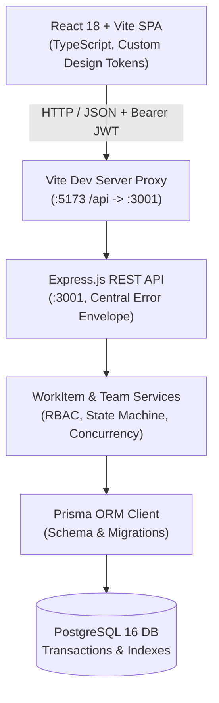
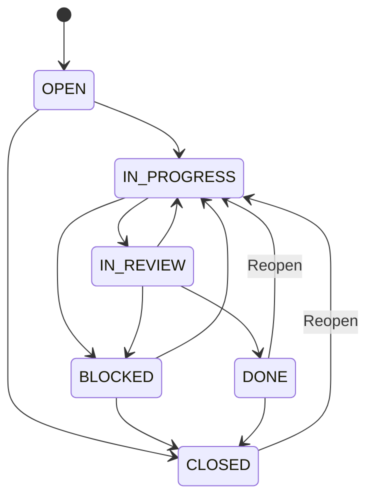

# Newtonite Ops — Internal Operations Management

[](https://nodejs.org/)
[](https://www.typescriptlang.org/)
[](https://react.dev/)
[](https://expressjs.com/)
[](https://www.prisma.io/)
[](https://www.postgresql.org/)
[](https://vitest.dev/)

Newtonite Ops is an internal operations management platform designed for speed, clarity, and concurrency safety. Inspired by Linear and modern enterprise admin consoles, it features a responsive single-page application frontend paired with a strictly typed REST backend backed by PostgreSQL.

---

## Table of Contents

- [Key Capabilities](#key-capabilities)
- [Architecture & Tech Stack](#architecture--tech-stack)
- [Quick Start Guide](#quick-start-guide)
- [Demo Credentials](#demo-credentials)
- [Core User Workflows](#core-user-workflows)
- [Role-Based Access Control (RBAC)](#role-based-access-control-rbac)
- [Workflow State Machine](#workflow-state-machine)
- [API Reference](#api-reference)
- [Testing & Quality Gates](#testing--quality-gates)
- [Repository Structure](#repository-structure)
- [Engineering Decisions & Trade-offs](#engineering-decisions--trade-offs)

---

## Key Capabilities

- **Linear-Inspired Enterprise Aesthetic**: Light canvas (`#f8fafc`), crisp white cards, subtle neutral borders, restrained elevation, and accessible WCAG AA color palettes for statuses and priorities.
- **Responsive Adaptive Layout**:
  - **Desktop**: Persistent collapsible sidebar (240px to 68px compact mode) and full 7-column data table.
  - **Tablet**: Compact layout with prioritized table columns to eliminate horizontal scrolling.
  - **Mobile**: Off-canvas sliding navigation drawer, stacked metric cards, card-styled work items, and full-width detail forms.
- **Optimistic Concurrency & 409 Conflict Reconciliation**: Every editable work-item mutation requires `expectedVersion`. If an item changes concurrently on the server:
  - The client receives `409 Conflict`.
  - The user's in-progress form draft is **strictly preserved** (never lost or silently overwritten).
  - A conflict reconciliation banner highlights rejected changes against the latest server version, offering explicit *"Reload latest (keeps my draft)"* and *"Discard my changes"* options.
- **Authoritative Server Authorization**: Display-only permission mirrors guide user experience, but all access checks and transition gates are enforced authoritatively in backend services.
- **Server-Backed Metrics & Deterministic Pagination**: Operational statistics are queried directly from database aggregations (never computed from page subsets). Pagination is server-driven with bounded sizes and stable sorting (`updatedAt DESC, id DESC`).
- **Transactional Audit Trail & Discussion**: Every work item mutation atomically records immutable `ActivityEvent` records with before/after diffs. Team members can post comments without altering work item versions.

---

## Architecture & Tech Stack



- **Frontend**: React 18, TypeScript, Vite, Vitest, Testing Library. Zero unnecessary third-party UI dependencies; crafted with semantic HTML, accessible CSS custom properties, and native SVG icons.
- **Backend**: Node.js, Express, TypeScript, Zod schema validation, bcryptjs, jsonwebtoken, Vitest, Supertest.
- **Data Layer**: PostgreSQL 16 (via Docker Compose) with Prisma ORM migrations and optimized compound indexes (`[teamId, status]`, `[teamId, updatedAt]`, `[workItemId, createdAt]`).

---

## Quick Start Guide

### Prerequisites
- **Node.js**: `>= 20.0.0`
- **npm**: `>= 10.0.0`
- **Docker**: Docker Desktop or Docker Engine (for local PostgreSQL)

### 1. Clone & Configure Environment

```bash
git clone https://github.com/Palakagarwal28/Newtonite_SE_.git
cd Newtonite_SE_

# Copy example environment variables
cp .env.example .env
```

*(On Windows PowerShell, use `Copy-Item .env.example .env`)*.

### 2. Start PostgreSQL Database

```bash
docker compose up -d postgres
```

### 3. Install Dependencies & Migrate Database

```bash
# Install all monorepo workspace dependencies
npm install

# Generate Prisma client and apply database migrations
npm run prisma:generate
npm run prisma:migrate

# Seed development accounts and initial teams (idempotent)
npm run seed -w backend
```

### 4. Run Development Servers

Open two terminal windows from the repository root:

```bash
# Terminal 1: Backend API server (runs at http://localhost:3001)
npm run dev:backend

# Terminal 2: Frontend Vite application (runs at http://localhost:5173)
npm run dev:frontend
```

Navigate your browser to **http://localhost:5173**.

---

## Demo Credentials

The backend seed script (`backend/prisma/seed.ts`) automatically creates the following accounts for local development and testing:

| Email | Password | Role / Scope | Key Permissions |
|---|---|---|---|
| `admin@example.com` | `Admin123!` | **Global Admin** | Create teams, access any team, manage members, edit/transition all work items |
| `manager.alpha@example.com` | `Manager123!` | **MANAGER** (Ops Central) | Transition work item statuses, assign team members, create/edit items |
| `member.alpha@example.com` | `Member123!` | **MEMBER** (Ops Central) | Create work items, edit title/description/priority, post comments |
| `outsider@example.com` | `Outsider123!` | **No Team** | Authenticated user without team assignments (demonstrates empty/access-denied states) |

> **Tip**: The login screen includes **one-click fill chips** for these accounts for instant testing without manual typing.

---

## Core User Workflows

### 1. Operations Dashboard
- **Live Metrics**: Overview cards displaying real-time server counts for `Total`, `Assigned to me`, `Urgent`, and individual statuses (`OPEN`, `IN_PROGRESS`, `BLOCKED`, `IN_REVIEW`, `DONE`, `CLOSED`).
- **Interactive Metric Filtering**: Clicking any metric card (e.g. "Urgent" or "Blocked") immediately filters the work-item list.
- **Search & Filters**: Debounced free-text search (queries both title and description server-side), team selection, priority selection, assignee filtering, and a one-click "Clear filters" action.

### 2. Creating Work Items
- Click **"New work item"** in the top bar or dashboard toolbar.
- Specify team, title, description, priority, and optional assignee (enforces assignee is a team member).
- Newly created items are born in `OPEN` status.

### 3. Reviewing & Editing Work Items
- Click any work item row or card to open the detail view.
- Members can update `Title`, `Description`, and `Priority`.
- Managers and Admins can update `Status` (restricted to legal transitions) and reassign team members.
- Saves submit `expectedVersion` to prevent accidental overwrites.

### 4. Concurrency Conflict (409) Handling
- If two users edit the same work item concurrently, the second save is rejected with `409 Conflict`.
- The user's unsaved edits remain intact in the input fields.
- The UI displays the server version conflict alongside the attempted changes.
- The user can choose to **"Reload latest (keeps my draft)"** to review the latest changes, or **"Discard my changes"** to revert.

### 5. Discussion & Activity Audit
- **Comments**: Any team member can add comments with duplicate-click prevention. Comments append to the timeline and do not bump the work-item version.
- **Activity Timeline**: Chronological audit trail showing actor, timestamp, version number, and exact field modifications (`status: "OPEN" → "IN_PROGRESS"`).

---

## Role-Based Access Control (RBAC)

Newtonite Ops distinguishes between platform-level **Global Admin** (`User.isGlobalAdmin`) and team-scoped roles (`Membership.role`):

| Capability | Global Admin | Team ADMIN | Team MANAGER | Team MEMBER | Non-Member |
|---|:---:|:---:|:---:|:---:|:---:|
| Create New Teams (`POST /api/teams`) | ✅ | ❌ | ❌ | ❌ | ❌ |
| View Team Details & Members | ✅ | ✅ | ✅ | ✅ | ❌ |
| Add / Remove Team Members | ✅ | ✅ | ❌ | ❌ | ❌ |
| Create Work Items | ✅ | ✅ | ✅ | ✅ | ❌ |
| Edit Title, Description, Priority | ✅ | ✅ | ✅ | ✅ | ❌ |
| Post Discussion Comments | ✅ | ✅ | ✅ | ✅ | ❌ |
| Change Work Item Status | ✅ | ✅ | ✅ | ❌ | ❌ |
| Assign / Reassign Work Items | ✅ | ✅ | ✅ | ❌ | ❌ |

---

## Workflow State Machine

Work items follow a defined lifecycle state machine enforced in `backend/src/work-items/transitions.ts`:



- Same-status updates are treated as safe no-ops (allowed without version increment).
- Illegal transitions are rejected by the API with HTTP `422 INVALID_STATUS_TRANSITION`.
- `DONE` (completed/verified) and `CLOSED` (terminated/wont-do) are kept distinct.

---

## API Reference

All protected endpoints require an `Authorization: Bearer <token>` header. Responses follow a standardized JSON envelope (`{ error: { code, message, details? } }` on failure).

### Authentication & Identity
| Method | Path | Access | Description |
|---|---|---|---|
| `POST` | `/api/auth/register` | Public | Register standard account (always `isGlobalAdmin: false`) |
| `POST` | `/api/auth/login` | Public | Authenticate with `{ email, password }` → `{ token, user }` |
| `GET` | `/api/auth/me` | Bearer | Retrieve caller identity and team memberships |

### Teams & Members
| Method | Path | Access | Description |
|---|---|---|---|
| `GET` | `/api/teams` | Bearer | List accessible teams (all for Global Admin) |
| `POST` | `/api/teams` | Global Admin | Create new team (creator joins as team `ADMIN`) |
| `GET` | `/api/teams/:id` | Member/Admin | Get team details |
| `GET` | `/api/teams/:id/members` | Member/Admin | List team members and their roles |
| `POST` | `/api/teams/:id/members` | Team/Global Admin | Add user to team with specified role |
| `DELETE` | `/api/teams/:id/members/:userId` | Team/Global Admin | Remove user from team (last admin protected) |

### Work Items
| Method | Path | Access | Description |
|---|---|---|---|
| `GET` | `/api/work-items` | Bearer | Search/filter work items with deterministic pagination |
| `POST` | `/api/work-items` | Member/Admin | Create new work item in `OPEN` status |
| `GET` | `/api/work-items/:id` | Member/Admin | Retrieve work item with recent comments and counts |
| `PATCH` | `/api/work-items/:id` | Member/Admin | Mutate fields (requires `expectedVersion`) |
| `POST` | `/api/work-items/:id/comments` | Member/Admin | Post comment (atomic audit, no version increment) |
| `GET` | `/api/work-items/:id/activity` | Member/Admin | Paginated activity timeline (newest-first) |

---

## Testing & Quality Gates

The monorepo includes unit tests, component tests, and API contract suites:

```bash
# 1. Typecheck both workspaces
npm run typecheck

# 2. Run frontend component & contract tests (26 tests, 5 suites)
npm run test -w frontend

# 3. Verify production bundle compilation
npm run build -w frontend

# 4. Run backend unit tests
npm run test -w backend
```

---

## Repository Structure

```
Newtonite-SE/
├── backend/
│   ├── prisma/
│   │   ├── migrations/         # PostgreSQL database schema migrations
│   │   ├── schema.prisma       # Prisma models: User, Team, WorkItem, etc.
│   │   └── seed.ts             # Idempotent development seeding script
│   ├── src/
│   │   ├── auth/               # JWT token utilities, passwords, and RBAC matrix
│   │   ├── routes/             # Express API routes (auth, teams, work-items, health)
│   │   ├── work-items/         # State machine, service logic, and concurrency
│   │   └── app.ts              # Express application and central error handler
│   └── tests/                  # Backend unit & integration test suites
├── frontend/
│   ├── src/
│   │   ├── components/         # Reusable UI: Badges, Icons, Sidebar, WorkItemCard
│   │   ├── views/              # Screens: Dashboard, Detail, Login
│   │   ├── api.ts              # Strictly typed backend API client and errors
│   │   ├── auth.tsx            # Session authentication provider & hook
│   │   ├── rules.ts            # Display-only permission and transition mirrors
│   │   ├── index.css           # Linear-inspired enterprise design tokens
│   │   └── App.tsx             # Responsive application shell & navigation
│   └── tests/                  # Frontend test suites (mocking fetch contracts)
├── docker-compose.yml          # PostgreSQL 16 container definition
├── ENGINEERING_DECISIONS.md    # Architectural decision records (ADRs)
├── package.json                # Monorepo workspaces definition
└── README.md                   # Project documentation
```

---

## Engineering Decisions & Trade-offs

Detailed rationales for all design choices are documented in [`ENGINEERING_DECISIONS.md`](./ENGINEERING_DECISIONS.md). Key highlights:

- **Optimistic Concurrency via `updateMany`**: Concurrency is implemented with a single atomic conditional query (`where: { id, version: expectedVersion }`). Stale versions immediately return `409 VERSION_CONFLICT` without modifying data or generating orphan audit logs.
- **Stateless Bearer JWTs**: Simplifies multi-instance deployment and dev proxying without session-store overhead. Tokens carry short 12-hour expiry, with database re-verification on sensitive calls.
- **Pure JavaScript `bcryptjs`**: Selected over native bcrypt bindings to ensure zero binary compilation headaches across cross-platform developer environments (macOS, Linux, Windows).
- **Separation of Authorization vs UI Mirrors**: Frontend components use client helpers (`rules.ts`) solely to optimize user interface feedback. The backend retains absolute authority over all permissions and state transitions.

---

## License

This project is proprietary and internal to Newtonite Operations. All rights reserved.
